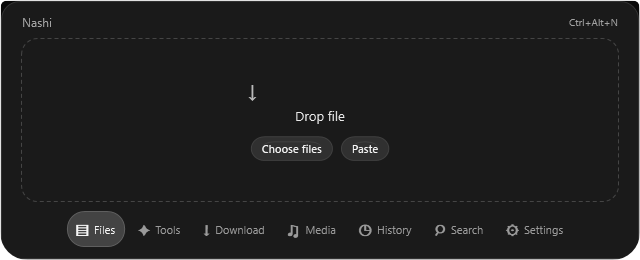
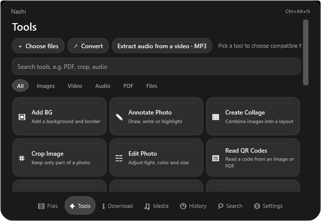
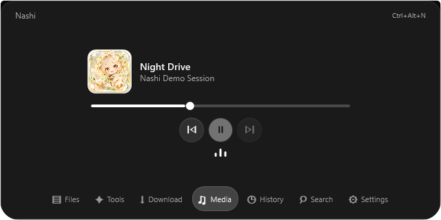

<p align="center"></p>
<h1 align="center">Nashi for Windows</h1>
<p align="center">A compact desktop workspace for files, tools and media.</p>
<p align="center"><a href="README.tr.md">Türkçe</a> · <a href="windows/README.md">Windows guide</a> · <a href="LICENSE">MIT license</a></p>

Nashi brings everyday file tasks into a small, keyboard-accessible Windows workspace. This repository contains a Windows-focused development of the open-source Nashi project, with a redesigned pill interface, a monochrome glass visual style and a new mascot.

> **Development build:** the redesigned Windows version is under active development. Screens below are isolated WPF renders with synthetic data, not demonstrations of every interaction. The downloadable package is an unsigned preview.

## The workspace



- **Files and conversion:** add or paste files, choose a target format, or open the tool wheel. File operations are designed to keep source files intact unless the user explicitly selects a file action such as Move.
- **Tools:** find image, PDF, media, archive and other tools in one searchable space. Availability depends on the input and installed runtime tools.
- **Web downloads:** open the Download section to prepare a public media link. Availability depends on the site and installed tools.
- **Media:** view the active Windows media session, control playback and see an output-level visualizer.
- **Pill controls:** choose shortcut, fixed, smart or peek visibility; configure the position, monitor, delays and keyboard shortcut in Settings.
- **Personal workspace:** history, notes, tasks and other modules are available from the dock or search.

| Tools | Media |
| :---: | :---: |
|  |  |

The visualizer reflects the default Windows output device, not an isolated application's audio. Smart visibility considers the foreground window; Peek responds to media changes and Nashi's own notifications. Full-screen games, anti-cheat software and physical multi-monitor setups still need broader testing.

## Download for Windows

[Download the Windows x64 preview ZIP](https://github.com/Alp-a-max/nashi-app/releases/tag/windows-preview-1) · Extract the whole archive and run `Nashi.exe`. The release page includes a SHA-256 checksum.

**Updates:** the built-in updater currently checks the original upstream Nashi release. Installing an offered update can replace this preview with the upstream app. Disable automatic checks in Settings → Updates and do not install an upstream update if you want to keep this version.

## Build and run

Windows x64 and the **.NET 10 SDK** are required to build. From the repository root:

```powershell
dotnet publish windows/Nashi.Windows -c Release -o build/windows/Nashi
.\build\windows\Nashi\Nashi.exe
```

The published build is self-contained. Keep its output files together. Some media and document features require optional tools installed through the app's setup flow. The existing update infrastructure belongs to upstream Nashi; this preview does not have an independent update feed.

Enable **pill mode** in Settings to use the compact workspace. Its default shortcut is **Ctrl+Alt+N**; it can be changed in Settings. **Ctrl+O** opens file selection, **Ctrl+V** imports clipboard contents outside text fields, and **Ctrl+Shift+D** opens a copied public media link.

## Project structure

- [`windows/Nashi.Windows`](windows/Nashi.Windows): WPF interface, pill window, media integration and Windows interactions.
- [`windows/Nashi.Core`](windows/Nashi.Core): file operations, preferences and shared Windows-side logic.
- [`windows/Nashi.Verify`](windows/Nashi.Verify): engine and safety checks.
- [`Sources`](Sources): the upstream macOS application and shared Swift components.

## Verification and limitations

```powershell
dotnet build windows/Nashi.Windows -c Release
dotnet run --project windows/Nashi.Verify -c Release
```

At commit `7fc6c1b`, the Windows Release build passed, the engine verification reported 1,397 passing checks, and isolated native checks covered settings reload, window behavior and file-control hit testing. These checks do not establish that every button, real mouse gesture or game scenario works. See [UI audit methodology](docs/testing/UI-AUDIT.md).

## Origins and license

This project is built on [orkunisitmak/nashi-app](https://github.com/orkunisitmak/nashi-app) and retains the original authors' [MIT license](LICENSE). The Windows pill redesign, customization and mascot presentation are the focus of this development branch. Visibility and interaction ideas were informed by [Nectar](https://github.com/kua8/Nectar); its GPL-3.0 code and assets were not copied. Third-party dependencies retain their own licenses; see [Windows notices](windows/THIRD-PARTY-NOTICES.txt) and [runtime dependencies](docs/dependencies.md).
