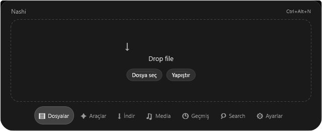
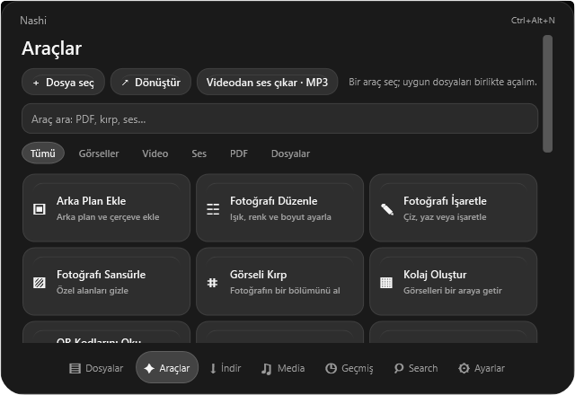
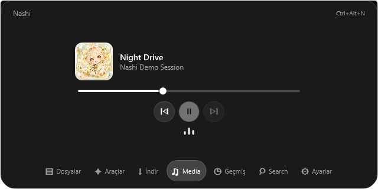

<p align="center"></p>
<h1 align="center">Nashi for Windows</h1>
<p align="center">Dosyalar, araçlar ve medya için kompakt bir masaüstü alanı.</p>
<p align="center"><a href="README.md">English</a> · <a href="windows/README.md">Windows rehberi</a> · <a href="LICENSE">MIT lisansı</a></p>

Nashi, sık kullanılan dosya işlemlerini küçük ve klavyeyle erişilebilir bir Windows çalışma alanında toplar. Bu depo, açık kaynak Nashi projesinin Windows odaklı geliştirmesini; yenilenmiş hap arayüzünü, monokrom cam tasarımını ve yeni maskotunu içerir.

> **Geliştirme sürümü:** Yenilenen Windows sürümü geliştirilmeye devam ediyor. Aşağıdaki görseller sentetik verilerle alınmış, uygulamanın kendi penceresine ait WPF renderlarıdır; tüm etkileşimlerin çalıştığının kanıtı değildir. Bu sürüm için bu depoda henüz bir yayın paketi bulunmuyor.

## Çalışma alanı



- **Dosyalar ve dönüşüm:** Dosya ekle veya yapıştır, hedef biçimi seç ya da araç çarkını aç. Taşı gibi açıkça seçilen işlemler dışında kaynak dosyalar korunacak şekilde tasarlanmıştır.
- **Araçlar:** Görsel, PDF, medya, arşiv ve diğer araçları aranabilir bir alanda bul. Kullanılabilirlik, dosyaya ve yüklü araçlara bağlıdır.
- **Web'den indir:** Herkese açık bir medya bağlantısını İndir bölümünde hazırla. Destek, siteye ve yüklü araçlara bağlıdır.
- **Medya:** Etkin Windows medya oturumunu gör, oynatmayı kontrol et ve ses düzeyi görselleştiricisini izle.
- **Hap seçenekleri:** Ayarlardan kısayol, sabit, akıllı veya Peek görünürlüğünü; konumu, ekranı, gecikmeleri ve kısayolu seç.
- **Kişisel alan:** Geçmiş, notlar, yapılacaklar ve diğer modüllere dock veya aramadan ulaş.

| Araçlar | Medya |
| :---: | :---: |
|  |  |

Görselleştirici tek bir uygulamanın sesini değil, varsayılan Windows çıkış aygıtının seviyesini gösterir. Akıllı mod ön plandaki pencereye bakar; Peek medya değişikliklerine ve Nashi'nin kendi bildirimlerine tepki verir. Tam ekran oyunlar, anti-cheat yazılımları ve fiziksel çoklu monitörler için daha fazla test gerekir.

## Derleme ve çalıştırma

Derlemek için Windows x64 ve **.NET 10 SDK** gerekir. Depo kökünde:

```powershell
dotnet publish windows/Nashi.Windows -c Release -o build/windows/Nashi
.\build\windows\Nashi\Nashi.exe
```

Çıktı kendi çalışma zamanını içerir; dosyaları aynı klasörde tut. Bazı medya ve belge özellikleri uygulamanın kurulum akışındaki ek araçları gerektirir. Mevcut güncelleme altyapısı kaynak Nashi projesine aittir; bu geliştirme dalı için ayrı bir güncelleme kaynağı veya yayın paketi ilan edilmemiştir.

Kompakt arayüz için Ayarlar'dan **hap modunu** etkinleştir. Varsayılan kısayol **Ctrl+Alt+N**'dir ve ayarlardan değiştirilebilir. **Ctrl+O** dosya seçiciyi, **Ctrl+V** metin alanları dışında pano içeriğini, **Ctrl+Shift+D** kopyalanmış herkese açık medya bağlantısını açar.

## Yapı ve doğrulama

Windows arayüzü [`windows/Nashi.Windows`](windows/Nashi.Windows), işlem mantığı [`windows/Nashi.Core`](windows/Nashi.Core), doğrulamalar [`windows/Nashi.Verify`](windows/Nashi.Verify) altındadır. Kaynak projeden gelen macOS uygulaması [`Sources`](Sources) klasöründedir.

```powershell
dotnet build windows/Nashi.Windows -c Release
dotnet run --project windows/Nashi.Verify -c Release
```

`7fc6c1b` commit'inde Windows Release derlemesi ve 1.397 motor kontrolü geçti. İzole yerel kontroller ayar yenilemesini, pencere davranışını ve dosya düğmelerinin tıklama alanını da kapsadı. Bu kontroller bütün düğmelerin, gerçek fare hareketlerinin veya oyun senaryolarının doğrulandığı anlamına gelmez. [Arayüz denetimi yöntemi](docs/testing/UI-AUDIT.md).

## Köken ve lisans

Bu çalışma [orkunisitmak/nashi-app](https://github.com/orkunisitmak/nashi-app) üzerine kuruludur ve asıl yazarların [MIT lisansı](LICENSE) korunur. Windows hap arayüzü, kişiselleştirme ve maskot sunumu bu geliştirme dalının odağıdır. Görünürlük ve etkileşim fikirlerinde [Nectar](https://github.com/kua8/Nectar) incelendi; GPL-3.0 lisanslı kodu ve görselleri kopyalanmadı. Bağımlılıkların lisansları için [Windows bildirimlerine](windows/THIRD-PARTY-NOTICES.txt) ve [çalışma zamanı bağımlılıklarına](docs/dependencies.md) bak.
